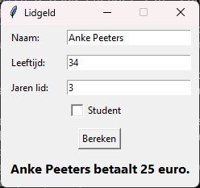
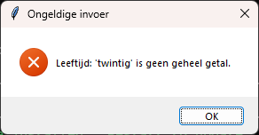

<!-- gemaakt met gereedschap/theorie-uitpakken.py uit de cursusmap pythonbasis -->
# Klassikale oefening 19.1 — De lidgeldcalculator

Uit *Python basis — theoriebundel*, hoofdstuk 19 (Grafische programma's met `tkinter`), paragraaf 19.9.

| Bestand | Deel | Opmerking |
|---|---|---|
| `uitwerking.py` | uitwerking | opent een venster |
| `berekeningen.py` | module uit 17.3 | nodig voor `uitwerking.py` |

## Opgave

**De situatie.** Het lidgeldprogramma uit hoofdstuk 15 vraagt alles met
`input()`. De penningmeester wil een venster: gegevens invullen, op **Bereken**
klikken, het bedrag zien. Foute invoer mag het programma nooit laten crashen.

**Wat je maakt.** Een bestand `lidgeld_venster.py` in je map `leeslamp`, naast
`berekeningen.py`, met:

1. Een klasse `LidgeldVenster`.
2. Invoervelden voor naam, leeftijd en jaren lidmaatschap, en een vakje voor
   student, geschikt met `grid()`.
3. Een knop **Bereken**, en Enter die hetzelfde doet.
4. Een foutmelding bij een lege naam, bij een leeftijd of aantal jaren dat geen
   geheel getal is, bij een negatief getal, en bij meer jaren lid dan de leeftijd.
5. De uitkomst in een label onder de knop.
6. De berekening zelf komt uit `berekeningen.py`.

## Uitwerking

```python
# De Leeslamp — de lidgeldcalculator met een venster
# Cursus Python basis, hoofdstuk 19, oefening 1

import tkinter as tk
from tkinter import messagebox

from berekeningen import bereken_lidgeld


class LidgeldVenster:
    """Een venster dat het lidgeld van één lid berekent."""

    def __init__(self, venster: tk.Tk):
        venster.title("Lidgeld")
        venster.resizable(False, False)

        tk.Label(venster, text="Naam:").grid(
            row=0, column=0, sticky="w", padx=10, pady=5)
        self.naam = tk.Entry(venster, width=25)
        self.naam.grid(row=0, column=1, padx=10, pady=5)

        tk.Label(venster, text="Leeftijd:").grid(
            row=1, column=0, sticky="w", padx=10, pady=5)
        self.leeftijd = tk.Entry(venster, width=25)
        self.leeftijd.grid(row=1, column=1, padx=10, pady=5)

        tk.Label(venster, text="Jaren lid:").grid(
            row=2, column=0, sticky="w", padx=10, pady=5)
        self.jaren = tk.Entry(venster, width=25)
        self.jaren.grid(row=2, column=1, padx=10, pady=5)

        self.student = tk.BooleanVar()
        tk.Checkbutton(venster, text="Student", variable=self.student).grid(
            row=3, column=1, sticky="w", padx=10)

        tk.Button(venster, text="Bereken", command=self.bereken).grid(
            row=4, column=0, columnspan=2, pady=10)

        self.uitkomst = tk.Label(venster, text="",
                                 font=("Segoe UI", 12, "bold"))
        self.uitkomst.grid(row=5, column=0, columnspan=2, pady=(0, 10))

        venster.bind("<Return>", lambda event: self.bereken())
        self.naam.focus()

    def lees_getal(self, veld: tk.Entry, omschrijving: str) -> int | None:
        """Het gehele getal in dit veld, of None na een foutmelding."""
        tekst = veld.get().strip()
        try:
            getal = int(tekst)
        except ValueError:
            messagebox.showerror(
                "Ongeldige invoer",
                f"{omschrijving}: '{tekst}' is geen geheel getal.")
            veld.focus()
            return None
        if getal < 0:
            messagebox.showerror(
                "Ongeldige invoer", f"{omschrijving} kan niet negatief zijn.")
            veld.focus()
            return None
        return getal

    def bereken(self) -> None:
        """Leest de velden, controleert ze en toont het lidgeld."""
        naam = self.naam.get().strip()
        if not naam:
            messagebox.showwarning("Naam ontbreekt", "Vul eerst een naam in.")
            self.naam.focus()
            return

        leeftijd = self.lees_getal(self.leeftijd, "Leeftijd")
        if leeftijd is None:
            return
        jaren = self.lees_getal(self.jaren, "Jaren lid")
        if jaren is None:
            return
        if jaren > leeftijd:
            messagebox.showerror(
                "Ongeldige invoer", f"{jaren} jaar lid op {leeftijd} jaar?")
            self.jaren.focus()
            return

        bedrag = bereken_lidgeld(leeftijd, self.student.get(), jaren)
        self.uitkomst.config(text=f"{naam} betaalt {bedrag} euro.")


if __name__ == "__main__":
    venster = tk.Tk()
    LidgeldVenster(venster)
    venster.mainloop()
```




Probeer zeker deze invoer. Elke rij test iets anders:

| Invoer | Wat je ziet | Wat het test |
|---|---|---|
| Anke Peeters, 34, 3 | Anke Peeters betaalt 25 euro. | Korting na drie jaar |
| Bram Coppens, 20, 1, student | Bram Coppens betaalt 15 euro. | Het studententarief |
| Cato Dhondt, 9, 0 | Cato Dhondt betaalt 0 euro. | Gratis onder de twaalf |
| Els Janssens, twintig, 1 | Leeftijd: 'twintig' is geen geheel getal. | De `ValueError` wordt opgevangen |
| Femke, 20, 25 | 25 jaar lid op 20 jaar? | Een onmogelijke combinatie |
| Lege naam | Vul eerst een naam in. | Een waarschuwing, geen fout |
| Hilde, 40, leeg veld | Jaren lid: '' is geen geheel getal. | Een leeg veld is ook ongeldige invoer |

**De zes ontwerpkeuzes.**

**`lees_getal` als hulpmethode.** Twee velden hebben dezelfde controle nodig. Je
schrijft ze één keer, met de omschrijving als parameter, zodat de foutmelding
toch zegt welk veld fout is. Dat is de regel uit hoofdstuk 11: wat je twee keer
schrijft, wordt een functie.

**`None` teruggeven na een foutmelding.** `lees_getal` toont zelf de melding en
geeft dan `None`. `bereken` stopt bij `None` meteen met `return`. Zo leest
`bereken` van boven naar onder, zonder diep geneste `if`'s. Het type
`int | None` lees je zoals `date | None` in oefening 17.1: een getal, of niets.

**`veld.focus()` na een fout.** De cursor springt naar het veld dat fout is. Een
kleine moeite, en de gebruiker hoeft niet te zoeken.

**`lambda event: self.bereken()` bij `bind`.** `bind` geeft altijd een event
mee, `command` niet. Zonder de parameter `event` krijg je bij Enter
`TypeError: <lambda>() takes 0 positional arguments but 1 was given`.

**`if __name__ == "__main__":` uit hoofdstuk 17.** Zo kun je `LidgeldVenster`
importeren zonder dat er meteen een venster opengaat. Dat heb je nodig zodra je
het venster wilt testen of in een groter programma wilt gebruiken.

**`resizable(False, False)`.** Het formulier heeft een vaste vorm. Uitrekken
levert alleen lege ruimte op, dus je zet het uit.
