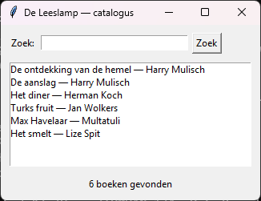
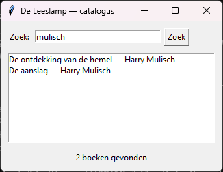

<!-- gemaakt met gereedschap/theorie-uitpakken.py uit de cursusmap pythonbasis -->
# Klassikale oefening 19.2 — Zoeken in de catalogus

Uit *Python basis — theoriebundel*, hoofdstuk 19 (Grafische programma's met `tkinter`), paragraaf 19.10.

| Bestand | Deel | Opmerking |
|---|---|---|
| `uitwerking.py` | uitwerking | opent een venster |

## Opgave

**De situatie.** Leden willen een stuk van een titel of een schrijver intypen en
meteen zien welke boeken passen. Dubbelklikken op een boek toont de details.

**Wat je maakt.** Een bestand `catalogus_venster.py` met:

1. Een functie `zoek_boeken(boeken, deel)` die los van het venster werkt:
   hoofdletterongevoelig, op titel én schrijver.
2. Een klasse `ZoekVenster` met:
   - bovenaan een zoekveld en een knop, naast elkaar in een `Frame`;
   - daaronder een `Listbox` met de gevonden boeken;
   - onderaan een label met het aantal, in correct Nederlands: 1 boek, 2 boeken.
3. Bij het openen staan alle boeken in de lijst.
4. Enter zoekt ook.
5. Een dubbelklik op een boek toont titel, schrijver en jaar in een melding.

## Uitwerking

```python
# De Leeslamp — zoeken in de catalogus
# Cursus Python basis, hoofdstuk 19, oefening 2

import tkinter as tk
from tkinter import messagebox

BOEKEN = [
    ("De ontdekking van de hemel", "Harry Mulisch", 1992),
    ("De aanslag", "Harry Mulisch", 1982),
    ("Het diner", "Herman Koch", 2009),
    ("Turks fruit", "Jan Wolkers", 1969),
    ("Max Havelaar", "Multatuli", 1860),
    ("Het smelt", "Lize Spit", 2016),
]


def zoek_boeken(boeken: list, deel: str) -> list:
    """Alle boeken waarvan titel of schrijver dit deel bevat."""
    deel = deel.strip().lower()
    return [
        boek for boek in boeken
        if deel in boek[0].lower() or deel in boek[1].lower()
    ]


class ZoekVenster:
    """Een venster om de catalogus te doorzoeken."""

    def __init__(self, venster: tk.Tk, boeken: list):
        self.boeken = boeken
        self.gevonden = []
        venster.title("De Leeslamp — catalogus")

        bovenaan = tk.Frame(venster)
        bovenaan.pack(fill="x", padx=10, pady=10)
        tk.Label(bovenaan, text="Zoek:").pack(side="left")
        self.zoekveld = tk.Entry(bovenaan, width=30)
        self.zoekveld.pack(side="left", padx=5)
        tk.Button(bovenaan, text="Zoek", command=self.zoek).pack(side="left")

        self.lijst = tk.Listbox(venster, width=50, height=8)
        self.lijst.pack(padx=10)
        self.lijst.bind("<Double-Button-1>", self.toon_details)

        self.teller = tk.Label(venster, text="")
        self.teller.pack(pady=10)

        venster.bind("<Return>", lambda event: self.zoek())
        self.zoekveld.focus()
        self.zoek()

    def zoek(self) -> None:
        """Vult de lijst met de boeken die passen bij de zoekterm."""
        self.gevonden = zoek_boeken(self.boeken, self.zoekveld.get())
        self.lijst.delete(0, tk.END)
        for titel, schrijver, jaar in self.gevonden:
            self.lijst.insert(tk.END, f"{titel} — {schrijver}")

        aantal = len(self.gevonden)
        woord = "boek" if aantal == 1 else "boeken"
        self.teller.config(text=f"{aantal} {woord} gevonden")

    def toon_details(self, event) -> None:
        """Toont titel, schrijver en jaar van het aangeklikte boek."""
        selectie = self.lijst.curselection()
        if not selectie:
            return
        titel, schrijver, jaar = self.gevonden[selectie[0]]
        messagebox.showinfo(titel, f"{titel}\n{schrijver}, {jaar}")


if __name__ == "__main__":
    venster = tk.Tk()
    ZoekVenster(venster, BOEKEN)
    venster.mainloop()
```




| Zoekterm | Gevonden | Waarom |
|---|---|---|
| (leeg) | 6 boeken | Een lege string zit in elke tekst |
| mulisch | 2 boeken | Gevonden via de schrijver |
| MULISCH | 2 boeken | Hoofdletters maken niet uit |
| koch | 1 boek | Enkelvoud in de teller |
| ha | 3 boeken | Harry twee keer, en Max Havelaar |
| xyz | 0 boeken | Een lege lijst, geen fout |

**De vijf punten.**

**Een `Frame` om `pack` te combineren.** Bovenaan staan drie widgets naast
elkaar met `side="left"`. Daaronder staan de lijst en de teller onder elkaar.
Een `Frame` is een eigen container met een eigen schikking. Daarom kan
`bovenaan` zijn inhoud naast elkaar zetten, terwijl het venster de rest onder
elkaar zet.

**`zoek_boeken` staat buiten de klasse.** Het is de scheiding uit 19.8. Je kunt
de functie testen met een gewone `print` of `assert`, zonder ooit een venster te
openen.

**`self.gevonden` bewaart de resultaten.** `curselection()` geeft alleen het
volgnummer in de lijst, als tuple, zoals `(1,)`. Niet het boek zelf. Met
`self.gevonden[selectie[0]]` vind je het boek terug. Zonder dat attribuut zou je
de tekst in de lijst opnieuw moeten ontleden.

**Een lege zoekterm vindt alles.** `"" in "Het diner"` is waar, voor elke tekst.
Je hoeft voor "alles tonen" dus geen aparte code te schrijven: het venster roept
bij het openen gewoon `zoek()` op met een leeg veld.

**Wat er nog ontbreekt.** Bij zes boeken is alles meteen gevonden. Bij
veertigduizend boeken loopt de lijst bij elke zoekopdracht helemaal door. In
hoofdstuk 20 zie je hoe een hashtabel dat oplost, en in hoofdstuk 21 hoe je meet
hoeveel sneller het gaat.
